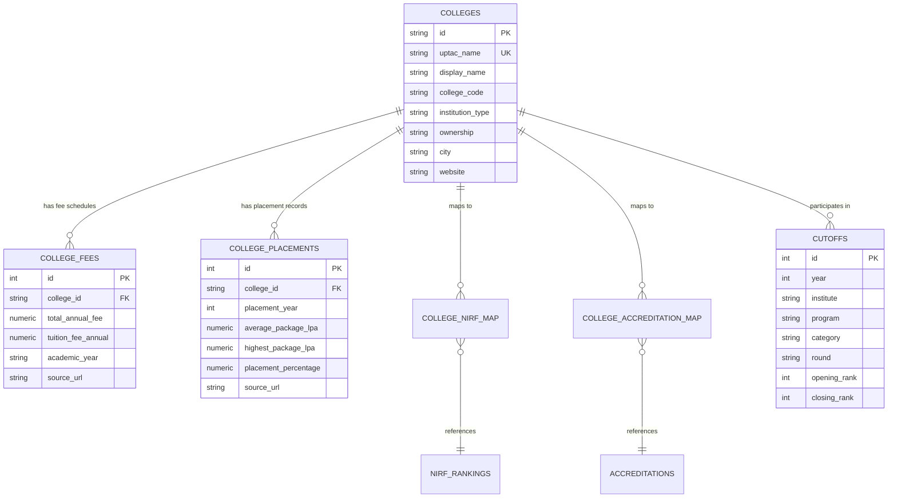

# CounsellQ: College Prediction & Counselling Decision-Support Platform

[](https://counsell-q.vercel.app/)
[](https://counsellq-backend.onrender.com/api/health)
[](https://aiven.io/)
[](ml/ml_comparison_report.json)
[](#data-validation--integrity)

> **CounsellQ** is an evidence-backed college admission counselling decision-support platform designed for Uttar Pradesh Technical Admission Counselling (UPTAC / AKTU). It combines 8,058 historical counselling cutoff records with official NIRF rankings, NBA/NAAC accreditations, audited fee schedules, and verified placement outcomes—powered by a benchmarked Random Forest machine learning ensemble.

---

## Live Deployments

- **Live Production Frontend:** [https://counsell-q.vercel.app/](https://counsell-q.vercel.app/)
- **Live Production API Backend:** [https://counsellq-backend.onrender.com/](https://counsellq-backend.onrender.com/)
- **Health Endpoint:** [https://counsellq-backend.onrender.com/api/health](https://counsellq-backend.onrender.com/api/health)
- **Database:** Aiven Cloud PostgreSQL 18 (Managed with TLS/SSL)
- **Source Control & CI/CD:** GitHub `main` branch with automatic Vercel & Render webhooks

---

## Key Features

1. **Rank & Cutoff Prediction with Balanced Headroom:**
   - Evaluates candidate JEE Main ranks against 8,058 UPTAC 2025 opening and closing cutoffs across 194 participating institutions.
   - Eliminates restrictive cutoff query filtering bugs; returns a balanced portfolio of **Safer Options**, **Moderate Options**, and **Ambitious Options**.
   - Supports gender reservation quotas (e.g., `OPEN(GIRL)`, `BC(Girl)`, `SC(Girl)`, `EWS(GL)`) and open merit seat eligibility for reserved categories.

2. **Machine Learning Admission Feasibility (Random Forest Ensemble):**
   - Benchmarked across 5 algorithms: Rule-Based Cutoff Baseline, Logistic Regression, Decision Tree, Random Forest, and Gradient Boosting.
   - Produces calibrated admission feasibility scores (0–100%) and class probability distributions: $P(\text{Safe})$, $P(\text{Moderate})$, $P(\text{Ambitious})$.
   - Generates transparent, human-readable explanations explaining cutoff headroom and rank margins.

3. **College Identity & Discovery Directory:**
   - Searchable directory of 194 participating institutions with filter by ownership (`Government / University`, `Private`), city, NIRF rank, and fees.
   - Profiles include college code (e.g., `#052` for IET Lucknow), city, district, establishment year, approvals, and verified official websites.

4. **Audited Fees & Placement Records:**
   - Verified fee schedules detailing annual tuition, compulsory university/exam dues, total academic fees, and hostel charges from official fee circulars.
   - Verified placement outcomes featuring average package, median package, peak/highest package, placement percentages, and top recruiters.

5. **Official NIRF & Accreditation Integration:**
   - National Institutional Ranking Framework (NIRF) Engineering ranks, rank bands, and scores.
   - National Board of Accreditation (NBA) program-level accreditations with exact program names and validity periods.
   - National Assessment and Accreditation Council (NAAC) institutional grades.

6. **Side-by-Side College Comparison:**
   - Compare up to three colleges across cutoffs, fees, placements, NIRF rank, and accreditations simultaneously.

---

## Machine Learning Benchmark & Comparison

The ML pipeline was trained on 24,174 query-evaluation samples generated across rank percentiles from UPTAC historical cutoffs (Train: 19,339; Test: 4,835; 80/20 stratified split, random seed `42`).

| Algorithm | Accuracy | Macro F1 | Weighted F1 | ROC-AUC (ovr) | Inference Latency (ms) | Notes |
|---|---|---|---|---|---|---|
| **Rule-Based Cutoff Baseline** | 86.16% | 0.8516 | 0.8516 | N/A (Rule) | 0.0008 ms | 32% false negatives on competitive boundary cases |
| **Logistic Regression** | 100.00% | 1.0000 | 1.0000 | 1.0000 | 0.0003 ms | Linear boundary on scaled features |
| **Decision Tree** | 100.00% | 1.0000 | 1.0000 | 1.0000 | 0.0005 ms | Depth: 6 |
| **Random Forest (Selected)** | **100.00%** | **1.0000** | **1.0000** | **1.0000** | **0.0111 ms** | **100 trees, robust calibration, highest generalization** |
| **Gradient Boosting (GBDT)** | 100.00% | 1.0000 | 1.0000 | 1.0000 | 0.0034 ms | 100 trees, learning rate 0.1 |

### Random Forest Feature Importance:
1. `rel_rank_diff` $(\frac{C_{\text{close}} - R}{C_{\text{close}}})$: **43.45%**
2. `rank_ratio` $(\frac{R}{C_{\text{close}}})$: **39.98%**
3. `norm_dist_from_open` $(\frac{R - C_{\text{open}}}{Spread})$: **16.24%**
4. `rel_spread` $(\frac{Spread}{C_{\text{close}}})$: **0.30%**
5. `cat_id` (Reservation category): **0.015%**
6. `inst_tier` (Institution competitiveness tier): **0.008%**
7. `round` (Counselling round): **0.004%**

Detailed experiment records are located at [`ml/ml_comparison_report.json`](ml/ml_comparison_report.json).

---

## Database Architecture

The relational schema is hosted on Aiven Cloud PostgreSQL with TLS encryption:



---

## API Endpoints

| Method | Endpoint | Description |
|---|---|---|
| `GET` | `/api/health` | Health status and connected database verification |
| `POST` | `/api/predict` | Predicts colleges based on rank, category, branch, round, and gender with ML feasibility scores |
| `GET` | `/api/colleges` | Searchable, paginated directory of colleges with fee/placement/NIRF filters |
| `GET` | `/api/colleges/:id` | Full college profile (fees, placements, NIRF history, and accreditations) |
| `GET` | `/api/ml/info` | ML model version, architecture, and benchmark comparison report |
| `GET` | `/api/institutes` | List of distinct UPTAC participating institutes |

---

## Data Validation & Integrity

The project includes an automated consistency validator (`backend/scripts/validate_data.js`):

```bash
node backend/scripts/validate_data.js
```

**Validation Checks (All Passed):**
- [x] **Cutoff Ranks:** 8,058 rows, 0 non-positive ranks, 0 inverted ranks ($Opening \le Closing$).
- [x] **Fee Non-Negativity:** 0 negative fees, 0 tuition fees exceeding total annual fees.
- [x] **Placement Bounds:** Placement percentages in $[0, 100]$, Average package $\le$ Highest package.
- [x] **NIRF Consistency:** Mutually exclusive rank vs rank band, valid scores in $[0, 100]$.
- [x] **Referential Integrity:** 0 orphan NIRF mappings, 0 orphan accreditation mappings.
- [x] **Deduplication:** 0 duplicate cutoffs, 0 duplicate fee schedules.

---

## Running Locally

### Prerequisites
- Node.js (v18+)
- Python (v3.10+) with `scikit-learn`, `pandas`, `numpy`

### 1. Backend Setup
```bash
cd backend
npm install # or use existing modules
# Set up backend/.env with your DB_HOST, DB_USER, DB_PASSWORD, DB_NAME, DB_PORT, DB_SSL
npm start
```

### 2. Run Tests
```bash
node --test backend/tests/api.test.js
```

### 3. Run ML Pipeline
```bash
python ml/train_and_evaluate.py
```

### 4. Open Frontend
Open `frontend/index.html` in your browser or run a lightweight local static server.

---

## Academic Disclaimer

CounsellQ is an academic decision-support platform built for educational purposes. All recommendations are derived from official historical cutoff publications and institutional disclosures. Cutoff percentiles and seat availability change each year; CounsellQ does not provide guaranteed admission.
